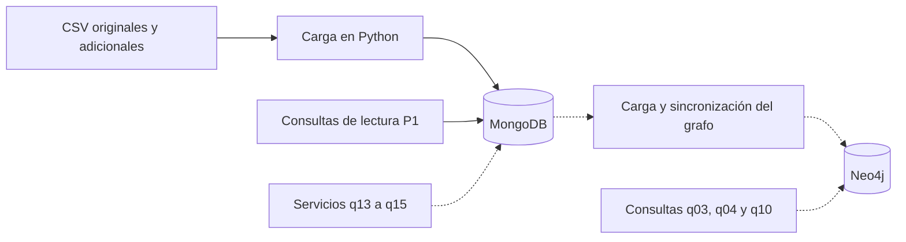
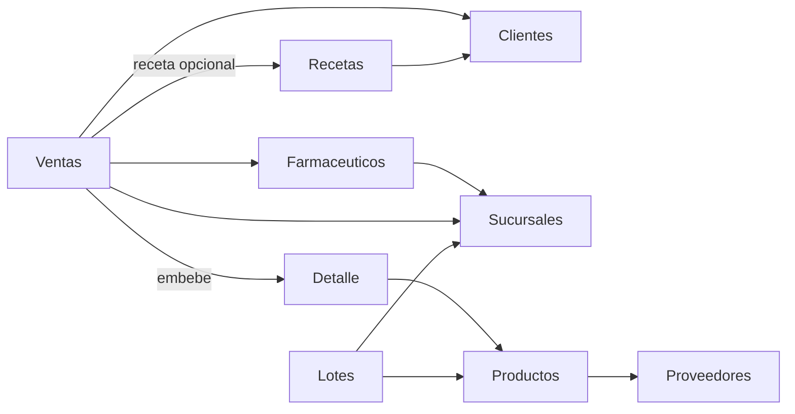
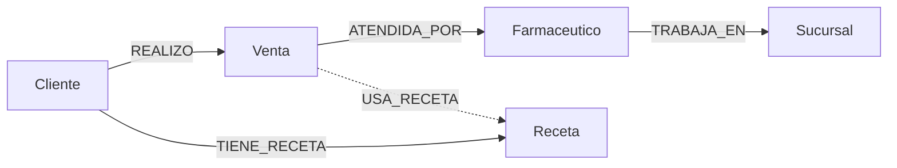

# Trabajo Práctico – Arquitectura Políglota de Bases de Datos

**Proyecto:** FarmaRed · Sistema de Gestión de Red de Farmacias  
**Materia:** Base de Datos II  
**Universidad:** Instituto Tecnológico de Buenos Aires (ITBA)  
**Cuatrimestre:** Segundo cuatrimestre de 2026  
**Grupo:** [Completar número de grupo]  
**Integrantes:** [Completar nombres, apellidos y legajos]  
**Repositorio GitHub:** [farmared-bd2](https://github.com/mcullen212/farmared-bd2)

# 1. Introducción

## 1.1. Objetivo del proyecto

Diseñar e implementar una arquitectura de persistencia políglota para FarmaRed que permita consultar y actualizar datos operativos y recorrer relaciones entre clientes, recetas, ventas y sucursales. La elección de cada motor responde a la estructura de los datos, los patrones de acceso y las garantías de consistencia que requiere cada operación.

## 1.2. Descripción del sistema

FarmaRed S.A. opera farmacias en Buenos Aires, Santa Fe y Córdoba y cuenta con una droguería propia que abastece a las sucursales. El sistema de backoffice debe gestionar clientes y su cobertura, farmacéuticos matriculados, proveedores, catálogo, recetas, ventas y stock por lote y vencimiento. Los farmacéuticos registran ventas y dispensas en las farmacias. La droguería mantiene existencias para la distribución.

## 1.3. Tecnologías utilizadas

| Tecnología | Propósito |
|---|---|
| MongoDB 8.0 | Persistencia documental de los datos operativos, agregaciones y transacciones. |
| Neo4j 5.26 | Motor configurado para la proyección de lectura del grafo, cuya carga está pendiente. |
| Python 3.12 y PyMongo | Carga de CSV, acceso a MongoDB y ejecución de consultas por terminal. |
| Docker Compose y GitHub Codespaces | Entorno reproducible con ambos motores y un contenedor de trabajo. |

# 2. Arquitectura políglota

## 2.1. Descripción general

MongoDB es la fuente de verdad de los datos operativos. El diseño prevé construir desde allí una proyección de lectura en Neo4j que conserva los identificadores de negocio y los atributos necesarios para las consultas de relaciones. Docker Compose configura MongoDB como replica set de un nodo y levanta Neo4j en la misma red del contenedor de trabajo.

Las líneas punteadas representan componentes pendientes de implementación. [Decisión de arquitectura](ARQUITECTURA_FARMARED.md)

## 2.2. Selección y justificación de motores

| Entidad o caso de uso | Motor | Justificación técnica |
|---|---|---|
| Ventas y su detalle | MongoDB | La cabecera y los ítems de longitud variable se leen juntos. Cada ítem conserva el precio aplicado. |
| Stock por lote y recetas | MongoDB | Tienen ciclos de actualización propios. El diseño permite modificar ambos junto con la venta en una sola transacción. |
| Clientes, farmacéuticos, sucursales, catálogo y proveedores | MongoDB | Se guardan como documentos independientes y se vinculan por ID. Los índices únicos protegen los identificadores, DNI y matrículas según corresponda. |
| Rankings, ingresos y actividad | MongoDB | Las agregaciones permiten filtrar, agrupar y sumar sobre las ventas y su detalle. |
| Historial, recetas por cliente y clientes atendidos en una sucursal | Neo4j | Los tres casos reutilizan relaciones entre clientes, ventas, recetas, farmacéuticos y sucursales. Cypher permite expresar sus recorridos como patrones. |

# 3. Modelo de datos

## 3.1. MongoDB

| Colección | Clave única de negocio | Estructura y referencias |
|---|---|---|
| `clientes` | `id_cliente`, `dni` | Identificación, contacto, cobertura y estado activo. |
| `sucursales` | `id_sucursal` | Datos de la sede y tipo Farmacia o Droguería. |
| `farmaceuticos` | `id_farmaceutico`, `matricula` | Profesionales vinculados a una sucursal. |
| `proveedores` | `id_proveedor` | Laboratorios y droguerías que proveen productos. |
| `productos` | `id_producto` | Catálogo, condición de venta, precio de lista e ID del proveedor. |
| `recetas` | `id_receta` | Cliente, emisión, estado, dispensas autorizadas y realizadas, y próxima dispensa. |
| `stock_lotes` | `id_lote` | Producto, sucursal, número de lote, unidades y vencimiento. |
| `ventas` | `id_venta` | Cliente, farmacéutico, sucursal, receta opcional, fecha, total, estado, detalle embebido y estado del movimiento de stock. |

Cada ítem de `ventas.detalle` guarda `id_detalle`, `id_producto`, `cantidad` y `precio_unit`. El precio histórico permite interpretar la venta aunque luego cambie el catálogo. La sucursal se guarda en la venta para conservar el contexto de atención ante una reasignación del farmacéutico. En los datos importados se toma la sucursal registrada para el profesional en los CSV.

La carga crea índices compuestos en `ventas(id_cliente, fecha)`, `ventas(id_farmaceutico, fecha)` y `stock_lotes(id_producto, id_sucursal, vencimiento, id_lote)`. También instala `vista_ingresos_por_farmaceutico`, que agrupa ventas completadas por farmacéutico, año y mes. El diseño reserva `proyeccion_pendiente` para registrar cambios que deban pasar al grafo.

## 3.2. Neo4j · Modelo diseñado

| Etiqueta | Propiedades previstas además de `id` |
|---|---|
| `Cliente` | Nombre, apellido y estado activo. |
| `Venta` | Fecha, estado, tipo y total. |
| `Receta` | Fecha de emisión, estado y tipo. |
| `Farmaceutico` | Nombre, apellido y estado activo. |
| `Sucursal` | Nombre. |

El modelo define una restricción única de `id` por etiqueta. El grafo conserva los datos necesarios para las lecturas previstas. Los documentos completos, incluidos los datos de contacto y los ítems de las ventas, se recuperan desde MongoDB por ID. [Contrato del modelo](MODELO.md)

# 4. Estrategia de carga de datos

## 4.1. Datos iniciales

Los datos ficticios provienen de nueve CSV de la cátedra en `data/original/`. Los CSV del equipo se guardan en `data/extra/`. El cargador convierte los importes y las cantidades a enteros, los indicadores de actividad a booleanos y los campos vacíos a `null`. Las fechas sin hora se representan a las 00:00 UTC del día calendario. Las consultas que dependen de hoy toman la fecha de negocio de Buenos Aires.

## 4.2. Proceso de carga

1. Leer los CSV originales y adicionales y validar los datos antes de escribir.
2. Agrupar los ítems por venta, verificar su total e incorporar el detalle a la cabecera. Las ventas completadas importadas quedan con movimiento de stock `historico`. Los lotes se importan con el saldo provisto.
3. Crear los índices y la vista de ingresos. Insertar en una transacción los registros cuyos IDs todavía no existen. Una segunda ejecución conserva los documentos ya cargados.
4. Construir la proyección de Neo4j a partir de MongoDB. Esta etapa está pendiente. El diseño utiliza restricciones de unicidad y `MERGE` por ID para permitir una recarga sin duplicados.

## 4.3. Registros adicionales incorporados

| Datos cargados en MongoDB | Originales | Adicionales | Total | Qué aportan los adicionales |
|---|---:|---:|---:|---|
| Clientes | 8 | 10 | 18 | Clientes sin ventas y clientes con varias recetas. |
| Sucursales | 5 | 10 | 15 | Más sedes para cruzar con lotes, ventas y farmacéuticos. |
| Farmacéuticos | 7 | 10 | 17 | Profesionales con distintos niveles de actividad. |
| Proveedores | 5 | 10 | 15 | Referencias para los productos adicionales. |
| Productos | 13 | 10 | 23 | Más productos para el catálogo, el ranking y las consultas de stock. |
| Recetas | 9 | 10 | 19 | Recetas adicionales asociadas a ventas y clientes, incluido un tratamiento prolongado. |
| Lotes | 18 | 10 | 28 | Casos con 0, 49 y 50 unidades para probar el límite de q08. |
| Ventas | 16 | 10 | 26 | Ventas recientes, antiguas, pendientes, completadas y anuladas. |
| Ítems de venta embebidos | 22 | 10 | 32 | Detalle para verificar totales y sumar unidades por producto. |

## 4.4. Verificación de datos

El cargador verifica IDs de negocio, DNI y matrículas únicos, referencias existentes, correspondencia entre receta y cliente y totales iguales a la suma de los ítems. La preparación de los CSV confirma ocho colecciones con los conteos de la tabla y 32 ítems embebidos. El README documenta cómo reiniciar `farmared_demo` y repetir la carga para comprobar que se informan cero registros nuevos por colección. La validación de referencias en Neo4j queda pendiente de la carga del grafo.

# 5. Implementación de consultas y servicios

## 5.1. Resumen de consultas

Las quince consultas y servicios de FarmaRed se distribuyen entre MongoDB y Neo4j. MongoDB concentra las lecturas operativas y los reportes de catálogo, ventas, recetas, stock y actividad de clientes y farmacéuticos (q01, q02, q05 a q09, q11 y q12), además del ABM de clientes, el registro de ventas y el descuento de stock por orden de vencimiento (q13 a q15). Neo4j reúne las consultas que recorren relaciones entre entidades para reconstruir el historial de ventas y recetas de un cliente (q03), identificar a quienes tienen más de una receta (q04) y obtener los clientes atendidos en una sucursal (q10).

## 5.2. Desarrollo de consultas

Los ejemplos muestran campos seleccionados de la primera fila de cada resultado registrado en `farmared_demo`. Las consultas se ejecutan con `python -m src.consultas_mongo qNN`, con `MONGODB_URI` apuntando a esa base. Los ejemplos de q05, q11 y q12 usan `--hoy 2026-11-12`. [Decisiones y resultados de referencia](DECISIONES_CONSULTAS_P1.md)

### Consulta 1 – Productos activos y sus proveedores

**Enunciado.** Productos activos con todos los datos de su proveedor.

**Implementación en MongoDB.** Filtra por `activo: true`, resuelve el proveedor por `id_proveedor` con `$lookup` y lo convierte en un documento anidado con `$unwind`. El criterio de actividad se aplica al producto. Una referencia huérfana quedaría excluida por `$unwind`. [Código de q01](../src/consultas/q01.py)

**Resultado.** 21 filas. El producto `PRD001` aparece con el proveedor `PRV001`.

### Consulta 2 – Ventas pendientes

**Enunciado.** Ventas en estado «Pendiente» con el farmacéutico asignado (nombre, matrícula y sucursal) y el total.

**Implementación en MongoDB.** Filtra las ventas pendientes antes de unir los datos del farmacéutico y de la sucursal con `$lookup`. Usa el `id_sucursal` de la venta para mantener la sede original ante reasignaciones. [Código de q02](../src/consultas/q02.py)

**Resultado.** 4 filas. La venta `V011`, asociada a `F006`, tiene un total de ARS 4.800.

### Consulta 3 – Historial de un cliente

**Enunciado.** Historial completo de un cliente dado su ID, con ventas y recetas ordenadas cronológicamente por fecha.

**Diseño en Neo4j.** Recorrer `REALIZO` y `TIENE_RECETA` desde el cliente y ordenar los eventos por fecha.

**Resultado.** Pendiente de implementación y ejecución.

### Consulta 4 – Clientes con más de una receta

**Enunciado.** Clientes con más de una receta registrada, indicando la cantidad.

**Diseño en Neo4j.** Contar las recetas vinculadas a cada cliente por `TIENE_RECETA` y devolver los conteos mayores que uno.

**Resultado.** Pendiente de implementación y ejecución.

### Consulta 5 – Actividad de farmacéuticos

**Enunciado.** Farmacéuticos activos y cantidad de ventas registradas en los últimos 60 días, excluyendo anuladas. Deben aparecer también los que tienen cero.

**Implementación en MongoDB.** Parte de los farmacéuticos activos y busca las ventas de cada uno entre el día actual y los 59 días previos, inclusive. Cuenta también las pendientes y devuelve cero si la búsqueda queda vacía. [Código de q05](../src/consultas/q05.py)

**Resultado.** 16 filas. Con `--hoy 2026-11-12`, el farmacéutico `F001` tiene 1 venta.

### Consulta 6 – Dispensas atrasadas

**Enunciado.** Recetas de tratamiento prolongado en estado «Vigente» cuya próxima dispensa es anterior a hoy, con los datos del cliente.

**Diseño en MongoDB.** Filtrar las recetas por tipo, estado y fecha de próxima dispensa y obtener el cliente por `id_cliente`.

**Resultado.** Pendiente de implementación y ejecución.

### Consulta 7 – Cinco productos más vendidos

**Enunciado.** Top 5 de productos más vendidos por unidades, considerando solo ventas «Completada».

**Implementación en MongoDB.** Filtra las ventas completadas, descompone el detalle y suma las cantidades por producto. Ordena por cantidad descendente y desempata por ID de producto. Busca los datos del catálogo después de limitar el resultado a cinco. [Código de q07](../src/consultas/q07.py)

**Resultado.** 5 filas. El producto `PRD005` encabeza el ranking con 6 unidades vendidas.

### Consulta 8 – Lotes con stock bajo

**Enunciado.** Lotes con menos de 50 unidades, indicando producto, sucursal y proveedor.

**Implementación en MongoDB.** Filtra por `unidades < 50`, incluyendo lotes con saldo cero. Recupera producto y sucursal por sus IDs, y obtiene el proveedor desde el producto. [Código de q08](../src/consultas/q08.py)

**Resultado.** 15 filas. El lote `L002` de `PRD001` tiene 35 unidades.

### Consulta 9 – Ventas libres de menos de ARS 5.000

**Enunciado.** Ventas de tipo «Venta libre» con total menor a ARS 5.000, excluyendo anuladas.

**Implementación en MongoDB.** Un `find` filtra por tipo, total estrictamente inferior a 5.000 y estado distinto de «Anulada». Devuelve la venta completa con sus ítems y admite ventas pendientes que cumplen el filtro. [Código de q09](../src/consultas/q09.py)

**Resultado.** 6 filas. La venta `V013` tiene un total de ARS 4.400.

### Consulta 10 – Clientes atendidos en una sucursal

**Enunciado.** Todos los clientes atendidos en una sucursal determinada, a través del farmacéutico que registró la venta, esté activo o no.

**Diseño en Neo4j.** Recorrer sucursal, farmacéutico, venta y cliente a partir del ID de sucursal y devolver clientes distintos. Se incluyen farmacéuticos inactivos.

**Resultado.** Pendiente de implementación y ejecución.

### Consulta 11 – Ingresos mensuales por farmacéutico

**Enunciado.** Vista agregada de ingresos totales por farmacéutico en el mes actual, considerando solo ventas «Completada».

**Implementación en MongoDB.** La vista `vista_ingresos_por_farmaceutico` suma los totales por farmacéutico, año y mes. La consulta filtra por el año y el mes del día de negocio. [Código de q11 y de la vista](../src/consultas/q11.py)

**Resultado.** 3 filas. Con `--hoy 2026-11-12`, el farmacéutico `F101` registra ingresos de ARS 13.200.

### Consulta 12 – Clientes sin ventas en el último año

**Enunciado.** Clientes sin ventas registradas en el último año.

**Implementación en MongoDB.** Parte de todos los clientes y busca como máximo una venta de cualquier estado dentro de la ventana. Devuelve quienes carecen de coincidencia, incluidos quienes nunca compraron. Los dos extremos son inclusivos. Si hoy es 29 de febrero, la fecha inicial es el 28 de febrero del año anterior. [Código de q12](../src/consultas/q12.py)

**Resultado.** 5 filas. Con `--hoy 2026-11-12`, uno de los clientes devueltos es `C004`.

### Consulta 13 – ABM de clientes

**Enunciado.** Alta con DNI único, modificación de datos de contacto y cobertura, y baja lógica de clientes.

**Diseño en MongoDB.** El índice único de DNI ya se crea en la carga. El servicio deberá traducir una violación de esa restricción en un rechazo, limitar las modificaciones a los campos permitidos y hacer la baja con `activo = false`. Los cambios que afecten el grafo deberán registrar una tarea de proyección.

**Resultado.** Pendientes los ejemplos de alta, modificación, baja y rechazo por DNI duplicado.

### Consulta 14 – Registro de venta

**Enunciado.** Registrar una venta completada con cabecera e ítems, validar cliente y farmacéutico activos, sucursal de tipo Farmacia, productos activos y, cuando corresponda, una receta vigente del mismo cliente. Calcular el total y actualizar la receta.

**Diseño en MongoDB.** El servicio toma precios de catálogo y aplica q15 con la misma sesión. Los cambios se confirman juntos según la estrategia de la sección 6.2.

**Resultado.** Pendientes los estados antes y después de una venta válida y del rechazo por stock insuficiente.

### Consulta 15 – Descuento masivo de stock

**Enunciado.** Dada una venta registrada, descontar las cantidades de cada producto de los lotes de la sucursal del farmacéutico en orden FEFO y omitir lotes vencidos. Rechazar toda la operación si el stock vigente es insuficiente para algún ítem.

**Avance en MongoDB.** El repositorio permite leer lotes disponibles por vencimiento e ID y decrementar un lote con condición de saldo suficiente. El servicio deberá coordinar todos los movimientos dentro de la misma transacción. [Código del repositorio](../src/repositorio_mongo.py)

**Resultado.** Pendientes las pruebas del servicio, incluidos el rechazo sin descuentos parciales y el reintento sin doble descuento.

# 6. Consistencia e integridad de datos

## 6.1. Estrategia general

La carga implementa validaciones de referencias y totales antes de insertar y crea índices únicos para las claves de negocio, el DNI y la matrícula. El detalle embebido mantiene juntos los ítems y la cabecera. El repositorio expone operaciones que reciben una sesión de PyMongo para que los servicios puedan compartir una transacción.

## 6.2. Consulta 14 – Registro de venta

El diseño agrupa la validación de la venta, el descuento de todos los ítems, la actualización de la receta y el registro del evento de proyección en una única transacción de MongoDB. Se aumenta una sola vez el contador de dispensas. Si quedan dispensas, la próxima se programa para 30 días después. Al completar la última, la receta pasa a «Completada» y su próxima dispensa queda en `null`.

Si falta stock para cualquier ítem, se aborta la transacción y se preservan la receta y los saldos previos. Para la prueba de reversión se documentó una venta en `S001` con una unidad de `PRD001` y otra de `PRD101`, con fecha de prueba 2026-11-11. El primer producto cuenta con el lote `L001` en esa sucursal y el segundo tiene stock en otra sede. La prueba integrada está pendiente.

## 6.3. Consulta 15 – Descuento masivo de stock

El diseño parte del ID de una venta completada y agrupa las cantidades por producto. Consume primero los lotes disponibles con vencimiento más próximo y desempata por ID. Cada decremento exige que el saldo alcance. Si un ítem queda sin cubrir, la transacción revierte todos los descuentos. El servicio reutiliza la sesión de q14 cuando se invoca desde el registro de venta y abre una transacción propia cuando se invoca por separado.

El repositorio ya implementa la selección FEFO y el decremento condicionado. Quedan pendientes la coordinación transaccional de todos los lotes, los reintentos por conflictos concurrentes y el guardado de la asignación en `movimiento_stock`. El diseño usa ese registro para impedir un descuento duplicado ante un reintento y para reconocer las ventas importadas como históricas.

## 6.4. Integridad entre motores

MongoDB conserva el estado operativo definitivo. El diseño registra, en la misma transacción que modifica los datos, una tarea en `proyeccion_pendiente` cuando el cambio afecta el grafo. Un consumidor actualizará Neo4j tras el commit, usando IDs compartidos y operaciones idempotentes, y marcará la tarea como procesada luego de aplicar los cambios.

Si Neo4j queda temporalmente indisponible, la tarea queda pendiente para reintento. La proyección admite consistencia eventual y se podrá reconstruir desde MongoDB. La venta, el stock y la receta requieren confirmación atómica en MongoDB. El consumidor y la verificación de recuperación están pendientes.

# 7. Limitaciones y alternativas evaluadas

## 7.1. Limitaciones de la solución

El avance actual cubre la carga y ocho consultas de MongoDB. Neo4j está configurado en el entorno, con su proyección y consultas pendientes. El replica set de desarrollo tiene un nodo, suficiente para utilizar transacciones en el entorno del trabajo. La elección de Neo4j se fundamenta en los recorridos de la consigna y queda pendiente la evaluación de rendimiento.

## 7.2. Alternativas evaluadas

| Decisión | Alternativa considerada | Motivo de elección |
|---|---|---|
| Mantener las recetas operativas en MongoDB y proyectar sus relaciones en Neo4j | Guardar las recetas únicamente en Neo4j, opción C | La opción elegida confirma la venta, el stock y la receta en un solo commit. La alternativa evita duplicar recetas, pero exige coordinar dos commits y recuperar operaciones interrumpidas. |

## 7.3. Próximos pasos

Completar la carga y sincronización del grafo, las siete consultas y servicios pendientes, y las pruebas de concurrencia y recuperación. Incorporar al informe el código y las salidas de las implementaciones pendientes, incluidos los estados antes y después para q13 a q15.

# 8. Conclusiones

El avance permite reproducir la preparación de 26 ventas con 32 ítems embebidos y documentar ocho consultas de lectura con resultados de referencia en MongoDB. El modelo reúne el detalle y los precios históricos en cada venta, mientras conserva lotes y recetas como documentos con ciclo de actualización propio. La proyección de Neo4j y la integración transaccional de los servicios de venta y stock completarán la validación del diseño.

# 9. Referencias

- [Enunciado del TPO FarmaRed](TPO_FarmaRed.pdf)
- [Decisión de arquitectura](ARQUITECTURA_FARMARED.md)
- [Contrato del modelo](MODELO.md)
- [Decisiones de las consultas de P1](DECISIONES_CONSULTAS_P1.md)
- [MongoDB · Transacciones](https://www.mongodb.com/docs/manual/core/transactions/)
- [Neo4j Cypher · MATCH](https://neo4j.com/docs/cypher-manual/current/clauses/match/)
- [Neo4j Cypher · MERGE](https://neo4j.com/docs/cypher-manual/current/clauses/merge/)

# 10. Anexos

- **Anexo A.** Los diagramas de arquitectura y de ambos modelos figuran en las secciones 2 y 3.
- **Anexo B.** [Script de carga de MongoDB](../src/carga_mongo.py), [CSV originales](../data/original/) y [CSV adicionales](../data/extra/).
- **Anexo C.** [Resultados de referencia de P1](DECISIONES_CONSULTAS_P1.md). Quedan pendientes las salidas completas para acompañar la entrega final.
- **Anexo D.** [Instrucciones de ejecución en Docker Compose y GitHub Codespaces](../README.md).
