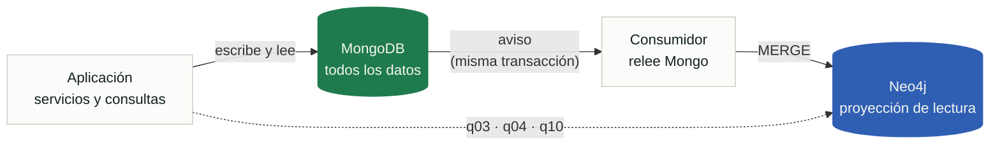
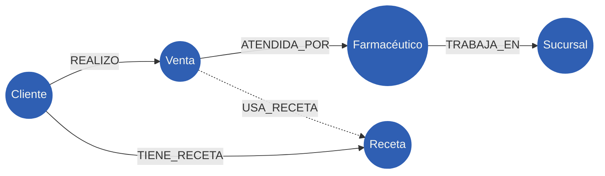

<div class="text-left w-full">

<p class="eyebrow">Base de Datos II · ITBA · 2026c2 · TPO</p>

<h1 style="font-size:4.5rem; font-weight:700">FarmaRed</h1>

<p class="lead" style="font-size:1.4rem; font-family:'Space Grotesk'">Persistencia políglota para una red de farmacias</p>

<p class="lead" style="font-size:0.8rem; margin-top:4rem">Grupo 7 — Jonathan Lucas Blankleder · Martina Schvartz Tallone · Magdalena Itziar Cullen De Erquiaga</p>

</div>

<!--
Presentarnos: somos el grupo 7. Vamos a contar qué motores elegimos, qué guarda cada uno, cómo cargamos los datos, y mostrar las consultas funcionando en vivo.
-->

---

<p class="eyebrow">El problema</p>

# Una red de farmacias que hoy vive en planillas

<p class="lead">FarmaRed quiere migrar su backoffice a una arquitectura de persistencia políglota: al menos dos motores NoSQL de paradigmas distintos, cada uno justificado por lo que necesita cada dato.</p>

<div class="grid grid-cols-3 gap-6 mt-10">
  <div class="stat" v-click><p class="big">9</p><p>entidades: clientes, ventas, recetas, stock por lote…</p></div>
  <div class="stat" v-click><p class="big">15</p><p>consultas y servicios, de q01 a q15</p></div>
  <div class="stat" v-click><p class="big">2</p><p>motores: MongoDB y Neo4j</p></div>
</div>

<!--
El enunciado pide pasar de planillas a al menos dos motores NoSQL distintos, justificando cada elección. Hay 9 entidades y 15 consultas y servicios. Elegimos MongoDB y Neo4j.
-->

---
class: alt
---

<p class="eyebrow">Arquitectura</p>

# Mongo es la fuente de verdad; Neo4j, una copia para recorrer



<p class="small mt-6">Si Neo4j se cae, las ventas se siguen registrando: los avisos quedan pendientes y se proyectan cuando vuelve. El grafo se puede borrar y reconstruir entero desde Mongo (consistencia eventual).</p>

<!--
Ningún dato vive solo en Neo4j. Todo se escribe en Mongo, y en la misma transacción se deja un aviso en proyeccion_pendiente. El consumidor (src/proyeccion/consumidor.py) lee esos avisos, relee el dato actual de Mongo y lo escribe en Neo4j con MERGE. Una venta nunca depende de que Neo4j esté levantado; el costo es que el grafo puede ir un poco atrasado.
-->

---

<span class="tag m">MongoDB · documentos</span>

# Por qué Mongo para el núcleo

| Lo que pide el enunciado | Lo que usamos de Mongo |
|---|---|
| Ventas con ítems de largo variable, muchas inserciones | Un documento por venta con el detalle embebido; índices por cliente y por farmacéutico + fecha |
| Stock por lote, concurrente y nunca negativo | `$inc` condicionado a que alcancen las unidades; transacciones multi-documento (replica set) |
| Clientes, recetas y farmacéuticos con ABM y baja lógica | Documentos con `activo`; índices únicos en DNI y matrícula |
| Catálogo y proveedores: mucha lectura | Colecciones de referencia que se cruzan con `$lookup` |
| Totales, rankings y conteos por período | Aggregation pipeline; una vista para los ingresos de q11 |

<!--
Cada fila sale de la tabla 3.2 del enunciado. Lo clave: la venta y su detalle son un solo documento, y Mongo tiene transacciones multi-documento, que necesitamos para que venta, stock y receta se confirmen juntos o nada.
-->

---
class: alt
---

<span class="tag n">Neo4j · grafos</span>

# Por qué Neo4j para los recorridos

<p class="lead">El enunciado habla de relaciones cliente–receta–venta que “se recorren en consultas de historial”. En un grafo eso es seguir flechas, sin joins.</p>

<div class="grid grid-cols-3 gap-4 mt-6">
  <div class="card n" v-click><p class="num">q03</p><h3>Historial de un cliente</h3><p>Desde el cliente: sus ventas (con farmacéutico y sucursal) y sus recetas, en orden.</p></div>
  <div class="card n" v-click><p class="num">q04</p><h3>Clientes con varias recetas</h3><p>Contar las relaciones TIENE_RECETA de cada cliente.</p></div>
  <div class="card n" v-click><p class="num">q10</p><h3>Clientes de una sucursal</h3><p>Tres saltos: sucursal ← farmacéutico ← venta ← cliente.</p></div>
</div>

<!--
Neo4j responde solo tres consultas, justo las que son recorridos. En Mongo q10 serían tres $lookup encadenados; en el grafo es un MATCH con tres flechas. Neo4j no es dueño de ningún dato: si se pierde, se reconstruye desde Mongo.
-->

---

<p class="eyebrow">Alternativas evaluadas</p>

# Lo que descartamos

<div class="grid grid-cols-2 gap-6 mt-6">
  <div class="card">
    <h3>Cassandra · columnar</h3>
    <p>Brilla con volúmenes enormes de escritura y consultas por clave de partición. Pero no tiene transacciones entre tablas (q14 y q15 tienen que ser atómicas), no hace joins ni agregaciones flexibles, y nuestro volumen es chico.</p>
  </div>
  <div class="card">
    <h3>Redis · clave-valor</h3>
    <p>Muy rápido, pero en memoria y pensado para buscar por clave: sin consultas ad hoc ni agregaciones como las que piden los reportes. Serviría como caché, no como fuente de verdad.</p>
  </div>
</div>

<!--
Las dos resuelven bien un problema que no es el nuestro. Cassandra conviene con millones de escrituras y consultas fijas por clave; acá lo crítico es la atomicidad de venta + stock + receta. Redis sería una buena caché delante de Mongo, pero no hace falta para este volumen.
-->

---
class: alt
---

<p class="eyebrow">Modelo de datos</p>

# Qué guarda cada base

<div class="grid grid-cols-[5fr_6fr] gap-10 mt-4">
<div>

<span class="tag m">MongoDB · todo el dominio</span>

<div class="chips mt-2">
  <span class="chip">clientes</span><span class="chip">sucursales</span>
  <span class="chip">farmaceuticos</span><span class="chip">proveedores</span>
  <span class="chip">productos</span><span class="chip">recetas</span>
  <span class="chip">stock_lotes</span><span class="chip">ventas + detalle</span>
</div>

<p class="small mt-3">El detalle va embebido en cada venta. Además: la cola <code>proyeccion_pendiente</code> y una vista de ingresos para q11.</p>

</div>
<div>

<span class="tag n">Neo4j · solo lo que se recorre</span>



<p class="small">Sin productos, proveedores, lotes ni datos de contacto: si una consulta los necesita, se buscan en Mongo por ID.</p>

</div>
</div>

<!--
Mongo guarda todo; el grafo solo tiene cinco tipos de nodo y cinco relaciones, las que necesitan q03, q04 y q10. Los IDs son los mismos en las dos bases (por ejemplo C001). USA_RECETA es punteada porque es opcional: una venta libre no usa receta.
-->

---

<p class="eyebrow">Carga de datos</p>

# Reproducible e idempotente

<div class="grid grid-cols-3 gap-4 mt-6">
  <div class="card m"><p class="num">1 · VALIDAR</p><h3>Antes de escribir</h3><p>Lee los CSV originales y los extra; revisa tipos, IDs y DNI únicos, que cada referencia exista y que el total de cada venta sea la suma de sus ítems.</p></div>
  <div class="card m"><p class="num">2 · INSERTAR</p><h3>En una transacción</h3><p>Upsert con <code>$setOnInsert</code>: correrlo dos veces da “0 nuevos” y no pisa lo que cambió en operación.</p></div>
  <div class="card n"><p class="num">3 · PROYECTAR</p><h3>Armar el grafo</h3><p>Lee Mongo y crea nodos y relaciones con <code>MERGE</code>: se puede borrar y reconstruir.</p></div>
</div>

<p class="small mt-6"><b>+10 registros por colección</b> para ejercitar las consultas: ventas de este mes, pendientes, anuladas y de hace más de un año; lotes en el borde de 50 unidades y sin stock; recetas vigentes y completadas.</p>

<!--
El loader (src/carga_mongo.py) valida todo en memoria antes de tocar la base: si un CSV tiene una referencia rota, no se escribe nada. Después inserta en una sola transacción. La segunda corrida no duplica nada. Los extras están pensados para los casos borde: por ejemplo, el lote de 49 unidades y el de 50 prueban el límite de q08.
-->

---
class: alt
---

<p class="eyebrow">Las 15 consultas</p>

# Cada consulta va al motor que mejor la resuelve

| Motor | Consultas | Cómo cruza entidades |
|---|---|---|
| MongoDB · lectura | q01 q02 q06 q08 q09 q12 | Referencias por ID, unidas con `$lookup` |
| MongoDB · agregación | q05 q07 q11 | Aggregation pipeline; q11 lee de una vista |
| MongoDB · servicios | q13 q14 q15 | Transacciones multi-documento |
| Neo4j · recorridos | q03 q04 q10 | Siguiendo relaciones del grafo |

<p class="small mt-6">Cada una vive en su módulo, <code>src/consultas/qNN.py</code>. Las que dependen de “hoy” usan la fecha del sistema.</p>

<!--
Doce consultas se resuelven en Mongo y tres en Neo4j. El detalle de las ventas no necesita join porque está embebido; el resto se cruza por ID con $lookup. Ahora las vemos funcionando en vivo.
-->

---
class: demo-head
---

<span class="tag m">Demo en vivo · MongoDB · agregación</span>

# q07: los 5 productos más vendidos

<div class="demo-grid">
<div>

```js
db.ventas.aggregate([
  {$match: {estado: "Completada"}},
  {$unwind: "$detalle"},
  {$group: {
     _id: "$detalle.id_producto",
     unidades: {$sum: "$detalle.cantidad"}}},
  {$sort: {unidades: -1}},
  {$limit: 5},
  {$lookup: {from: "productos", …}}
])
```

<p class="demo-note"><b>$unwind</b> abre el detalle embebido de cada venta: no hace falta otra colección para los ítems.</p>

</div>
<Terminal cmd="demo 1" />
</div>

<!--
Hacer clic en la terminal y escribir: demo 1. Para pasar a la slide siguiente, hacer clic fuera de la terminal (en el título) y usar la flecha. Explicar: filtra ventas Completada, $unwind separa cada ítem del detalle embebido, $group suma por producto, $lookup trae el nombre del catálogo.
-->

---

<p class="eyebrow">Consistencia · q14 + q15</p>

# Registrar una venta: todo o nada

<div class="steps mt-4">
  <div class="step"><p class="n">1</p><p class="t">Validar</p><p class="b">Cliente, farmacéutico, productos y receta.</p></div>
  <div class="step"><p class="n">2</p><p class="t">Insertar la venta</p><p class="b">Total calculado con precios del catálogo.</p></div>
  <div class="step"><p class="n">3</p><p class="t">q15: descontar stock</p><p class="b">FEFO, sin lotes vencidos ni stock negativo.</p></div>
  <div class="step"><p class="n">4</p><p class="t">Actualizar la receta</p><p class="b">Suma la dispensa; si era la última, Completada.</p></div>
  <div class="step"><p class="n">5</p><p class="t">Avisar al grafo</p><p class="b">Deja un aviso para que Neo4j se actualice.</p></div>
</div>
<div class="bracket"></div>
<p class="small text-center">Una sola transacción de MongoDB</p>

<div class="callout mt-4" v-click>
  <p class="t">Si falta stock de un ítem, se revierte todo</p>
  <p>Incluido lo que ya se había descontado de otros productos. No queda venta, ni dispensa, ni aviso. Lo vemos ahora en vivo.</p>
</div>

<!--
Si el descuento de stock falla, no puede quedar ni la venta ni la receta modificada. Lo resolvemos con una transacción de Mongo que envuelve los cinco pasos. Dentro de q15, cada descuento es un $inc que solo se aplica si el lote tiene unidades suficientes, así el stock nunca queda negativo aunque haya dos ventas a la vez.
-->

---
class: demo-head
---

<span class="tag m">Demo en vivo · MongoDB · q14 + q15</span>

# C006 compra 42 Amoxicilinas con su receta

<div class="demo-grid">
<div>

```python
registrar_venta(db, {
  "id_cliente": "C006",
  "id_farmaceutico": "F002",
  "id_receta": "RC004",
  "detalle": [{
    "id_producto": "PRD003",
    "cantidad": 42}],
}, hoy=date(2026, 11, 16))
```

<p class="demo-note">Mirar el <b>antes</b> y el <b>después</b> de los lotes (FEFO: vence antes, sale antes), de la receta y de los avisos para Neo4j.</p>

</div>
<Terminal cmd="demo 2" />
</div>

<!--
Escribir demo 2. Primero muestra el ANTES y espera Enter. Después de Enter: L005 pasa de 40 a 0 y L015 de 100 a 98 (FEFO), la receta de 1 a 2 de 3 con próxima dispensa a 30 días, y queda 1 aviso para Neo4j. Todo en una sola transacción.
-->

---
class: demo-head
---

<span class="tag m">Demo en vivo · MongoDB · q14 + q15</span>

# La misma venta, más un producto sin stock

<div class="demo-grid">
<div>

```python
registrar_venta(db, {
  "id_cliente": "C006",
  "id_receta": "RC004",
  "detalle": [
    {"id_producto": "PRD003",
     "cantidad": 1},
    {"id_producto": "PRD005",
     "cantidad": 1}],
  …}, hoy=date(2026, 11, 16))
```

<p class="demo-note">PRD003 (Amoxicilina) tiene stock en Palermo. PRD005 (Metformina) no tiene ningún lote ahí.</p>

</div>
<Terminal cmd="demo 3" />
</div>

<!--
Escribir demo 3. Sale "Venta rechazada" y se ve que nada cambió: no existe VDEMO2, L015 sigue en 98, la receta sigue en 2 de 3 y sigue habiendo 1 aviso. La Amoxicilina sí tenía stock y q15 llegó a descontarla antes de fallar, pero la transacción deshizo también ese descuento.
-->

---
class: demo-head
---

<span class="tag n">Demo en vivo · Neo4j</span>

# q03: historial de C006 en el grafo

<div class="demo-grid">
<div>

```cypher
MATCH (c:Cliente {id: $id_cliente})
CALL (c) {
  MATCH (c)-[:REALIZO]->(v:Venta)
  OPTIONAL MATCH
    (v)-[:ATENDIDA_POR]->(f)
  OPTIONAL MATCH
    (f)-[:TRABAJA_EN]->(s)
  RETURN …   // una fila por venta
  UNION
  MATCH (c)-[:TIENE_RECETA]->(r)
  RETURN …   // una fila por receta
}
RETURN item ORDER BY item.fecha
```

<p class="demo-note">Primero sin la venta nueva; después de correr el consumidor, aparece.</p>

</div>
<Terminal cmd="demo 4" />
</div>

<!--
Escribir demo 4. El historial todavía no tiene VDEMO1: Mongo ya la tiene, el grafo no (consistencia eventual). Enter: corre el consumidor, que procesa el aviso. Y ahora VDEMO1 aparece. La consulta es un recorrido desde el cliente: ventas con farmacéutico y sucursal, y recetas.
-->

---
class: demo-head
---

<span class="tag n">Demo en vivo · Neo4j</span>

# q10: clientes atendidos en la sucursal S002

<div class="demo-grid">
<div>

```cypher
MATCH (s:Sucursal {id: $id_sucursal})
      <-[:TRABAJA_EN]-(f:Farmaceutico)
      <-[:ATENDIDA_POR]-(v:Venta)
      <-[:REALIZO]-(c:Cliente)
RETURN DISTINCT c.id, c.nombre,
       c.apellido, c.activo
```

<p class="demo-note">El enunciado pide contar al farmacéutico “esté activo o no”: C004 aparece aunque lo atendió F004, que está dado de baja.</p>

</div>
<Terminal cmd="demo 5" />
</div>

<!--
Escribir demo 5. Tres saltos hacia atrás desde la sucursal. En Mongo serían tres $lookup encadenados; acá es un solo MATCH. C001 llega por Carolina Benítez (activa) y C004 por Julián Pereyra (inactivo).
-->

---
class: alt
---

<p class="eyebrow">Integridad</p>

# Sin claves foráneas, ¿quién cuida las referencias?

<div class="grid grid-cols-2 gap-4 mt-6">
  <div class="card" v-click><h3>La aplicación valida</h3><p>La carga y q14 verifican que exista cada cliente, farmacéutico, producto y receta antes de escribir.</p></div>
  <div class="card" v-click><h3>Índices únicos</h3><p>Por ID en cada colección, más DNI y matrícula en Mongo. En Neo4j, una restricción única por id en cada tipo de nodo.</p></div>
  <div class="card" v-click><h3>Lo que va junto, embebido</h3><p>Los ítems viven dentro de su venta: no pueden quedar huérfanos.</p></div>
  <div class="card" v-click><h3>Mongo → Neo4j</h3><p>El aviso se guarda en la misma transacción que el cambio. Si Neo4j falla, se reintenta hasta 5 veces y después queda marcado como error.</p></div>
</div>

<!--
Ni Mongo ni Neo4j garantizan integridad referencial, así que la resolvemos con validación en la aplicación, índices únicos, embebido donde la relación es parte-todo, y el aviso en la misma transacción para sincronizar los motores. Como el consumidor relee el dato actual, procesar dos veces el mismo aviso no rompe nada.
-->

---

<p class="eyebrow">Manejo de errores</p>

# Cuando algo falla, la base no queda a medias

| Qué puede fallar | Qué hacemos |
|---|---|
| Datos inválidos: cliente inactivo, receta vencida, obra social inexistente, campos de más | Se valida antes de escribir y se rechaza con un mensaje claro (“Rechazado: …”). La base no cambia. |
| Duplicados: DNI o ID de venta repetido | Lo frena el índice único de Mongo, aunque lleguen dos altas a la vez. Se traduce a “Ya existe un cliente con DNI …”. |
| Una venta falla a mitad de camino: falta stock, o otra venta tocó el mismo lote o la receta | Las escrituras son condicionales (`$inc` solo si alcanza; la receta solo si no cambió). Si una no aplica, se aborta y la transacción revierte todo. PyMongo reintenta los errores transitorios. |
| Un CSV con errores en la carga | Se valida todo en memoria primero; el error dice archivo y línea, y no se escribe nada. |
| Neo4j caído o falla al proyectar | La venta se confirma igual y el aviso queda pendiente. Hasta 5 reintentos; después queda en “error” con el último mensaje. |

<!--
Lo importante: ningún error deja la base a medias. Las validaciones van antes de escribir; lo que no se puede validar antes (duplicados, concurrencia, stock) se resuelve con índices únicos y escrituras condicionales dentro de una transacción. Además las operaciones se pueden repetir sin daño: q15 no descuenta dos veces la misma venta, la carga no duplica, y el consumidor relee el estado actual de Mongo.
-->

---
class: dark
---

<p class="eyebrow">Limitaciones y conclusiones</p>

# Cada motor hace lo que mejor sabe

<div class="grid grid-cols-2 gap-12 mt-6">
<div>

### Limitaciones

- El grafo puede ir un poco atrasado respecto de Mongo (consistencia eventual).
- El consumidor se corre aparte; pensado para una sola instancia.
- Neo4j Community no permite exigir que una propiedad exista.

</div>
<div>

### Conclusión

<p class="lead">MongoDB garantiza las escrituras: una venta, su stock y su receta se confirman juntos o no se confirman. Neo4j responde los recorridos sin joins, y como es una proyección, se puede reconstruir en cualquier momento.</p>

</div>
</div>

<!--
Elegimos que Mongo sea la única fuente de verdad para no tener que coordinar transacciones entre dos motores. El precio es la consistencia eventual del grafo, que para consultas de historial es aceptable. Abrir a preguntas.
-->
